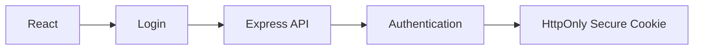
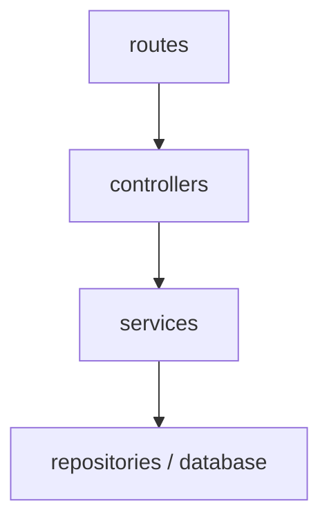

# 🏗️ GameVault — Architecture & Technology

> **Document:** `project-architecture.md`
> **Purpose:** The "how" — why each technology exists, where it is used, how data, auth, and the API are organized, and the engineering rules the project follows.

**Related docs:** [PRD](./Game-Vault-PRD.md) · [Figma Todos](./Figma-Todos.md) · [Features](./project-features.md)

> 📌 If this document disagrees with the PRD or `Figma-Todos.md`, those two win.

---

## 📑 Table of Contents

1. [Technology usage](#-1-technology-usage)
2. [Data stores](#-2-data-stores)
3. [Caching](#-3-caching)
4. [Authentication](#-4-authentication)
5. [Authorization](#-5-authorization)
6. [API architecture](#-6-api-architecture)
7. [Error handling](#-7-error-handling)
8. [Security](#-8-security)
9. [Frontend structure and rules](#-9-frontend-structure-and-rules)
10. [Scope and philosophy](#-10-scope-and-philosophy)

---

## 🧱 1. Technology usage

### 🖥️ Frontend

| Technology | Used for | Notes |
|---|---|---|
| **React** | UI, components, pages, forms, client-side architecture | |
| **TypeScript** | Everywhere: frontend, backend, API models, props, Redux state, RTK Query, DB types | No JavaScript-only source files in the main app |
| **Vite** | Dev server and build | |
| **React Router** | Routing, dynamic routes, nested layouts (public layout, app shell), protected routes | |
| **Redux Toolkit** | Shared client state: UI state, notifications, chat client state | Not everything belongs in Redux; keep local state local |
| **RTK Query** | Server state: fetching, caching, loading/error state, refetching, invalidation | Sits on top of Axios |
| **Axios** | HTTP transport: base URL, credentials, headers, error handling | One centralized instance |
| **React Hook Form** | Complex forms: login, register, review, collection, profile, password reset, messages | |
| **Yup** | Frontend validation schemas | The backend must still validate independently |
| **CSS Modules** | Primary styling: component-scoped styles, full design control, clean JSX | Tailwind intentionally **not** used; one `.module.css` per component |
| **React.lazy + Suspense** | Route-level code splitting | |
| **Sonner** *(or equivalent)* | Toast notifications, including the achievement-unlock toast during an active game session | |
| **socket.io-client** | One shared, authenticated realtime connection for chat, presence, and notifications | Wrapped in a shared service exposed through React Context or a custom hook; advanced release |
| **IntersectionObserver** | Infinite scrolling (Explore and Community feed) | Avoids polling scroll position; backed by pagination/cursor requests |
| **Debounce** | Explore title search and Community username search | One request after typing pauses, not one per keystroke |
| **Service Worker / PWA** | Offline support, app-shell caching, installable app, background sync | Advanced release |
| **IndexedDB** | Offline structured data, review drafts, pending actions | Advanced release |
| **localStorage** | Small preferences — primarily `theme` | **Never** for auth tokens |

**RTK Query API slices:** `authApi` · `gamesApi` · `libraryApi` (Library + Wishlist) · `collectionsApi` · `usersApi` (profile, follows) · `communityApi` (feed) · `notificationsApi` · `messagesApi` · `reviewsApi`

### ⚙️ Backend

| Technology | Used for |
|---|---|
| **Node.js + Express** | REST API, routes, middleware, authentication, authorization, validation, error handling, business logic, DB communication |
| **Socket.IO** | Real-time chat, online/offline presence, and real-time notifications over **one authenticated connection** |

**REST vs Socket.IO** — REST handles persistent data operations; Socket.IO handles real-time events. Socket.IO must **not** replace REST.

#### Shared Socket.IO connection

- **One** authenticated connection per client serves chat, presence, and notifications — never a separate connection just for presence.
- The server authenticates the socket from the session and **derives presence from authenticated connections and lifecycle events**, never from a client claim.
- **Multi-tab/device safe:** keep a per-user count (or set) of active sockets; a user goes offline only when the last one disconnects. Allow for delay after abrupt network/browser failure (heartbeat/timeout).
- Conversation membership is verified server-side on every join/send; never trust a client-supplied conversation ID.
- An **in-memory presence registry** is enough for a single server. A Redis/shared adapter is a later option for multi-instance deployment, not an initial requirement.

---

## 🗄️ 2. Data stores

| Store | Role | Used for |
|---|---|---|
| 🐘 **PostgreSQL (Neon)** | Primary database, hosted on [Neon](https://neon.tech) | Users, sessions, games (local metadata), Library, Wishlist, Collections + items, Follows, Notifications, game play sessions, Achievements + unlock records, Ratings, conversation metadata, relationships |
| 🍃 **MongoDB** | Secondary DB — **planned for the advanced/later phase**; exact responsibilities not decided yet. Not a mandatory dependency for the first implementation | Candidates: Reviews, Activity feed |
| ⚡ **Redis** | Support layer, never primary — **planned for the advanced/later phase**; exact responsibilities not decided yet. Not mandatory initially | Caching, rate limiting, temporary data, session data if needed, Socket.IO adapter for multi-instance presence |
| 🌐 **IndexedDB** | Browser-side storage | Offline data, cached structured data, offline review drafts, pending sync actions |

```
User
 ├── Library entries ├── Wishlist ├── Collections ├── Reviews
 └── Followers       └── Notifications └── Messages
```

### 🐘 Neon (PostgreSQL) setup notes

- **Connection string** lives in `DATABASE_URL` (server-side env only, never committed or exposed to the frontend). Neon requires SSL (`sslmode=require`).
- **Two connection types:** use the *pooled* connection string for the running API, and the *direct* (unpooled) one for migrations.
- **Environments:** use separate Neon branches (or projects) for development and production, so local work never touches production data.
- **Cold starts:** idle Neon compute can auto-suspend, so the first query after a pause may be slower. Account for it in health checks and the DB client's connection timeout.
- It is standard PostgreSQL — nothing in the schema or queries is Neon-specific, so the choice of driver/ORM and migration tool stays open.

> 🍃 **MongoDB must not be added just to look advanced.** It is planned for the advanced phase, and it stays only if the project can answer: *"Why is this data in MongoDB instead of PostgreSQL?"* If there is no convincing answer, PostgreSQL handles it. Its exact responsibilities (and Redis's) are decided in that phase, not in Phase 0.

### 🎮 Game catalog and images

- **Ownership:** game records are curated and added to the project's own PostgreSQL database by the project owner. The app does **not** fetch its catalog from external game-data providers, and regular users cannot create or add game records.
- **Serving:** the custom Game Vault API serves game records from this database.
- **Images:** game images live in the frontend project's `public` directory (e.g. `public/images/games/`). The database stores each image's **relative public path** — never the image file itself and never a Google Drive link. The API returns the path with the game data, and the frontend uses it as the image source.
- **Format and naming:** prefer optimized formats (WebP or AVIF) and keep file naming consistent. Lazy-load images where appropriate.
- **Catalogue fields that drive Explore:** title, release year, genres, developer, platforms, rating (one consistent, identified source), and a single integer **estimated playtime in hours**. Only filters and sorts backed by these fields are exposed. The estimated playtime is descriptive and is never used as an achievement threshold or completion signal.

```json
{ "title": "Cyberpunk 2077", "coverImage": "/images/games/cyberpunk-2077.webp" }
```

> The snippet shows the path convention only — it is not a finalized schema. User uploads (avatars, covers) are a separate concern: see [Features → Image upload](./project-features.md#7-image-upload).

---

## ⚡ 3. Caching

> Caching must have a **clear purpose** and must **never** compromise authorization or expose one user's data to another.

| Layer | Tool | Responsible for |
|---|---|---|
| **Client** | RTK Query | Game details/lists, reviews, Library, profile data — loading/error states, request caching, refetching, tag invalidation |
| **Server** | Redis *(planned for the advanced phase; not mandatory initially)* | Only where it has a real, measured benefit: popular/trending games, frequently requested game details, expensive read-heavy responses. User-specific data only with care |

---

## 🔐 4. Authentication



- Use **secure cookie-based sessions** — never a casual mix of session cookies, access tokens, and refresh tokens.
- **Session lifetime: 3 days.** The session ID is stored in a cookie; session details and validation are handled on the server side.
- The session identifier is **never** stored in `localStorage`; protected requests use the authentication cookie.
- Cookie attributes: `HttpOnly`, `Secure` in production, appropriate `SameSite` — final settings are chosen during authentication implementation. CORS and credential handling must match the deployment.
- **The server validates the session** — frontend state alone never proves a user is authenticated.
- Passwords are always hashed. Responsibilities: register · login · logout · current user · password reset · authorization. OAuth is optional/later.

---

## 🛡️ 5. Authorization

Backend authorization must **verify ownership**. A user can only edit/delete **their own** review, collection, library entries, and profile.

> 🛑 A user must not be able to modify another user's resources simply by changing an ID in the request.

---

## 🔌 6. API architecture

Resource-oriented REST using `GET` · `POST` · `PATCH` · `DELETE`. Define request/response contracts **before** connecting the UI.

### Endpoint reference

> The endpoints below are a **provisional overview**. Detailed endpoints and contracts (and the database schemas behind them) are designed in each domain's own phase, not finalized in Phase 0.

| Domain (phase) | Endpoints |
|---|---|
| **Auth** (3) | `POST /api/auth/register` · `POST /api/auth/login` · `POST /api/auth/logout` · `GET /api/auth/me` *(+ recovery endpoints if included)* |
| **Dashboard** (4) | `GET /api/dashboard` |
| **Games** (5) — *read-only for users; records are curated by the owner. `GET /api/games` supports title search, genre, release-year range, developer, platform, rating range, estimated-playtime range, sort by name/rating/estimated playtime (asc/desc), and controlled pagination or cursor fetching for infinite scroll* | `GET /api/games` · `GET /api/games/:gameId` |
| **Library** (5) | `GET /api/library` · `POST /api/library` · `PATCH /api/library/:entryId` · `DELETE /api/library/:entryId` |
| **Wishlist** (5) | `GET /api/wishlist` · `POST /api/wishlist` · `DELETE /api/wishlist/:entryId` |
| **Collections** (6) | `GET /api/collections` · `POST /api/collections` · `GET/PATCH/DELETE /api/collections/:collectionId` · `POST /api/collections/:collectionId/games` · `DELETE /api/collections/:collectionId/games/:gameId` |
| **Profile** (7) | `GET /api/users/:username` · `PATCH /api/users/me` · `GET/PATCH /api/users/me/settings` |
| **Social** (8) — *the feed is open-world (publicly readable); `filter` selects All / Following / Reviews / Achievement Unlocks and Following requires auth; cursor-based pagination for infinite scroll; username search is its own endpoint (defined in this phase)* | `POST/DELETE /api/users/:userId/follow` · `GET /api/users/:userId/followers` · `GET /api/users/:userId/following` · `GET /api/users?search=` · `GET /api/community/feed` |
| **Notifications** (9) — *feeds the Notifications page and the header bell's unread indicator* | `GET /api/notifications` · `PATCH /api/notifications/:notificationId/read` · `POST /api/notifications/read-all` |
| **Reviews** (10) | `GET/POST /api/games/:gameId/reviews` · `PATCH/DELETE /api/reviews/:reviewId` |
| **Messaging** (11) | `GET/POST /api/conversations` · `GET/POST /api/conversations/:conversationId/messages` + Socket.IO |
| **Sessions and achievements** (12) — *the backend validates conditions and persists unlocks; duplicate unlocks prevented per user/game/achievement* | `POST /api/games/:gameId/sessions` (start) · `PATCH /api/sessions/:sessionId` (exit / progress) · `GET /api/games/:gameId/achievements` · `GET /api/users/:userId/achievements` |

> Favorites *(optional)* get their own endpoints only if implemented.

### Backend layering

> Business logic must **not** live directly in route handlers. The exact architecture can be finalized before implementation.



### Feature sequence

For every backend feature: user story → data models → request/response contracts → validation and permissions → service + DB operations → controller/route → middleware → consistent errors → test success and failure → integrate frontend → test the full flow → document the endpoint.

### Design rules

- Consistent resource naming; correct HTTP methods and status codes.
- Validate every request on the backend.
- **Never trust user IDs or ownership information from the client.**
- Return only fields the caller may access.
- Paginate potentially large collections.
- Keep database logic out of UI components and reusable business logic out of route handlers.
- Document any external API dependency. The game catalog has none — it is served from the project's own database.

---

## 🚨 7. Error handling

One consistent error format on the backend; meaningful UI states on the frontend — never raw errors.

| Code | Meaning |
|---|---|
| `400` | Bad Request |
| `401` | Unauthorized |
| `403` | Forbidden |
| `404` | Not Found |
| `409` | Conflict |
| `429` | Too Many Requests |
| `500` | Internal Server Error |

**Frontend UI states:** error message · retry · empty · loading · skeleton · offline indicator

---

## 🔒 8. Security

- [ ] Password hashing
- [ ] HttpOnly cookies (Secure in production) and SameSite configuration
- [ ] CORS configuration
- [ ] CSRF considerations for cookie-based auth
- [ ] Input validation and safe output handling
- [ ] Authorization checks on every private resource
- [ ] Rate limiting on sensitive endpoints
- [ ] File upload validation — size limits and allowed MIME types
- [ ] Environment variables (including the Neon `DATABASE_URL`); **no secrets in source control**

---

## 🧩 9. Frontend structure and rules

### Folder structure

Domain-specific components live in their feature folder; only reusable visuals live in `components/`.

```
src/
├── app/
│   ├── router/
│   └── store/
├── components/
│   ├── common/        Button · Input · Modal · Dropdown · Avatar · Badge · Toast · Skeleton · EmptyState · ErrorState
│   └── layout/        PublicLayout (public header, footer) · AppShell (side nav, bottom nav, header)
├── features/          domain UI, logic, and RTK Query slices
│   ├── auth/
│   ├── dashboard/
│   ├── games/         GameCard · GameGrid · GameHero · ExploreFilters (RangePopover, GenreChips) · SortControl · ScreenshotGallery
│   ├── library/       Library tab and Wishlist modal
│   ├── collections/   CollectionCard · CollectionForm
│   ├── community/     ActivityItem/List · FeedFilters · UsernameSearch
│   ├── messages/      ConversationList/Item · ChatWindow · MessageBubble · MessageInput
│   ├── notifications/ NotificationBell (unread indicator, in AppShell header) · NotificationList · NotificationItem
│   ├── profile/       ProfileHeader · ProfileStats · ProfileTabs
│   ├── reviews/       ReviewCard · ReviewList · ReviewForm
│   ├── sessions/      GameSessionControl (Start/Exit Game, timer)
│   └── achievements/  AchievementCard · AchievementToast
├── pages/             public/ (Home, Features, About, Terms) · auth/ · app pages
├── services/          Axios instance · socket (shared Socket.IO client)
├── hooks/
├── styles/
├── types/
└── utils/
```

> 🃏 `GameCard` and `GameGrid` are reused in Games, Dashboard, Related Games, Wishlist, and Collection Details — build them first and keep them generic.

### Page composition

| Page | Key components |
|---|---|
| **Public Home** | Navbar (links to the public sibling pages, Login / Register) · Hero (featured game, content, actions) · featured games · benefits · community preview · final CTA · Footer |
| **Public sibling pages** (Features, About, Terms) | Same PublicLayout (Navbar + Footer) · page header · content sections · CTA to Register |
| **Dashboard** | WelcomeHeader · FeaturedBanner · MetricRow · PlayingGames · SavedGames · WishlistPreview · RecentAchievements · ActivityPreview (game sections reuse `GameGrid`/`GameCard`, each with a ghost "See All") |
| **Games hub** | PageHeader (with WishlistButton) · tabs (Explore, then Library) |
| **Explore** | TitleSearch · GenreChips · RangePopover (release year, rating, estimated playtime) · DeveloperSelect · PlatformMultiSelect · SortControl (name, rating, estimated playtime) · ResultCount · ActiveFilterChips · GameGrid · LoadingSkeleton · InfiniteScrollTrigger · MobileFilterDrawer |
| **Library** | LibraryHeader (count) · LibrarySearch · StatusFilter (Playing, Saved, Completed) · SortControl · GameGrid of LibraryGameCards · SignInPrompt (guests) |
| **Wishlist** *(modal on the Games page)* | WishlistButton (count badge) · WishlistModal (list, RemoveAction, MoveToLibrary, empty state) |
| **Game Details** | GameHero (background, cover, info, actions incl. Start/Exit Game) · Description · ScreenshotGallery · Metadata · Achievements (playtime / completion / optional) · Reviews (summary, form, list) · RelatedGames |
| **Community** | UsernameSearch · FeedFilters (All, Following, Reviews, Achievement Unlocks) · ActivityList (review and achievement-unlock cards) · InfiniteScrollTrigger |
| **Notifications** *(page)* | NotificationList · NotificationItem · MarkAllRead · empty/loading/error states (the header NotificationBell shows the unread indicator) |
| **Messages** | ConversationList · ChatWindow (header, MessageList, MessageInput) · PresenceIndicator · ConnectionStatus |
| **My Collections** | CreateCollectionButton · CollectionGrid |
| **Collection Details** | CollectionHeader (cover, title, description, actions) · CollectionInfo (owner, visibility, count) · GameGrid |
| **Profile** *(own and other users')* | ProfileHeader (cover, avatar, name, bio, Follow / Message, counts) · ProfileStats · ProfileTabs (Overview, Library, Reviews, Collections, Activity) · EditProfileModal (owner) · FollowListModal |
| **Settings** | Profile & Account · Privacy · Appearance (ThemeSelector) — only these three |
| **Auth** | LoginForm · RegisterForm · ForgotPasswordForm · ResetPasswordForm · OAuthButtons *(if enabled)* |

### Component responsibilities

| Layer | Responsibility |
|---|---|
| Pages | Compose feature components |
| Feature components | Domain-specific UI |
| Shared components | Reusable visual behavior |
| API modules | Centralize server communication |
| RTK Query | Server-state fetching and caching |
| Redux slices | Client state that genuinely needs sharing |
| Local state | Local interactions |
| Custom hooks / utils | Reusable behavior / pure operations |

### State management rules

- **RTK Query** for server data (games, Library, Collections, notifications).
- **Redux slices** for shared client state when appropriate; **local state** for isolated UI.
- **Context** only when it suits the specific shared concern — the shared Socket.IO client is a good fit (Context or a custom hook). Don't put all state into Context or Redux.
- **Infinite-scroll lists** (Explore, Community): reset loaded results whenever the query, filters, or sort change; keep search, filters, and sort as combined state rather than overwriting one another.
- Never duplicate server data across RTK Query and hand-maintained slices without a specific reason.

### Form rules

- React Hook Form for state and submission; Yup for reusable schemas.
- Show field-level errors and handle server-side validation errors.
- Block resubmission while a request is in progress; give clear success and failure feedback.

---

## 🧭 10. Scope and philosophy

**Later learning stage (after the main build):** Docker → CI/CD. Testing and deployment are part of the main roadmap (PRD phases 14–15).

| Principle | Meaning |
|---|---|
| **Quality over quantity** | Not every possible feature needs to be implemented |
| **Real technical reasons** | A technology is introduced because the project needs it |
| **Strong UI** | A polished, custom visual identity |
| **Maintainability** | Components, services, state, API, and DB logic have clear responsibilities |
| **Learning** | New technologies are learned when a real requirement introduces them |
| **Resume value** | Shows the developer can combine frontend, backend, databases, authentication, state management, caching, real-time communication, offline web, UI/UX, and TypeScript — without becoming a huge production platform |
