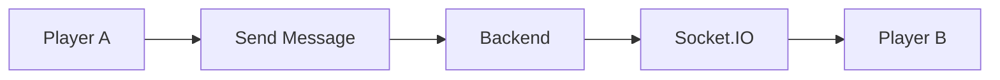
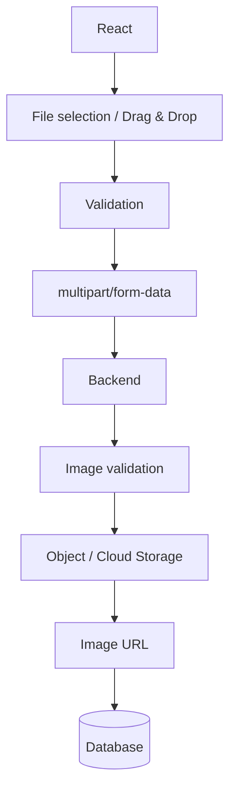
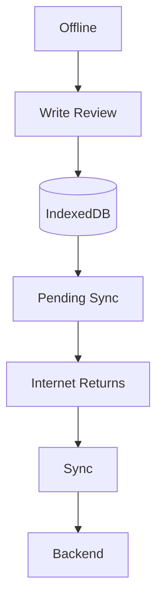

# 🎮 GameVault — Features

> **Document:** `project-features.md`
> **Purpose:** What each feature does and which rules apply to it. Release timing is in the PRD, page layout in Figma Todos, and technology/data decisions in Architecture.

**Related docs:** [PRD](./Game-Vault-PRD.md) · [Figma Todos](./Figma-Todos.md) · [Architecture](./project-architecture.md)

> 📌 If this document disagrees with the PRD or `Figma-Todos.md`, those two win.

---

## 📑 Table of Contents

1. [Project goal](#1-project-goal)
2. [Core features](#2-core-features)
3. [Social features](#3-social-features)
4. [Chat](#4-chat)
5. [Notifications](#5-notifications)
6. [Gaming statistics](#6-gaming-statistics)
7. [Image upload](#7-image-upload)
8. [PWA and offline support](#8-pwa-and-offline-support)
9. [Theme and preferences](#9-theme-and-preferences)

---

## 1. Project goal

GameVault is a **game-discovery, personal-library, and social platform**: users discover games, manage a personal library, track play sessions and achievements, review games, and interact with other players. Visual direction: **Cinematic Gaming** — dark by default, red accent `#E53945`.

It is intentionally **not** an infinitely complex commercial product — it should *feel* like a realistic production app while staying manageable as a portfolio piece.

| Area | Skills demonstrated |
|---|---|
| **Frontend** | React, TypeScript, Redux Toolkit, RTK Query, modern architecture, responsive UI, advanced CSS |
| **Backend** | REST API, backend architecture, authentication and authorization |
| **Data** | Relational design, document-store concepts (MongoDB, planned for the advanced phase), caching (Redis, planned for the advanced phase) |
| **Real-time and offline** | Socket.IO (chat, presence, notifications), PWA and offline functionality |
| **Craft** | Professional project structure |

---

## 2. Core features

### 🌍 Public website

A site cannot be a single page, so the public side is a small set of sibling pages that anybody can open, signed in or not:

| Route | Page |
|---|---|
| `/` | Home — product introduction, Hero, featured games, benefits, community preview, CTA |
| `/features` | What GameVault offers |
| `/about` | The project and its purpose |
| `/terms` | Terms of use |

Login and Register are linked from every public page. Once a login or registration is processed successfully, the user **enters the web application** at `/dashboard`, which has five main pages: **Dashboard, Games, Community, Collections, and Profile**.

### 🔐 Authentication

Register / login / logout · forgot and reset password · current user · protected routes · authorization · HttpOnly cookies · user roles *(where necessary)* · OAuth login *(optional, later)*. A successful login or registration lands on the Dashboard.

Sessions are cookie-based and last **3 days**: the session ID lives in a cookie and the server validates it.

### 📊 Dashboard — `/dashboard`

The signed-in user's **personal overview** and the page they land on after login/register. It is distinct from the public Home page.

| Section | Shows |
|---|---|
| 🎬 Header · featured banner | Welcome header; featured game or cinematic banner |
| 📈 Metrics | A small set of high-level metrics — not an overcrowded row |
| ▶️ Currently Playing | Games being played (tracked through active sessions), with "Continue Playing" |
| 🔖 Saved | Games **already in the library** that the user hasn't started |
| 💝 Wishlist preview | Games the user wants to **acquire** later; ghost-style "See All" opens the Wishlist modal |
| 🏆 Recent achievements | Latest unlocks *(once achievements exist)* |
| 👥 Activity | Followed users' recent activity, where supported |

Saved and Wishlist stay distinct — never the same concept twice. Each game section shows a short slice with a "See All" link. Game posters may show up to four or five progress metrics (progress %, total playtime, achievements unlocked/total, status, last played), only where they can be calculated reliably.

### 🔍 Games — Explore — `/games`

**Games** is one primary destination with two tabs, **Explore** first and then **Library** (signed in), plus a **Wishlist** button that opens a modal.

**The catalog is curated.** Game records are added to Game Vault's own database by the project owner and served by the custom API — there is no external game-data provider, and regular users cannot add games. Game images are static files in the frontend's `public` directory; each game record carries the image's relative path (e.g. `/images/games/cyberpunk-2077.webp`).

**Game card (compact):** title · release year · genre · rating (from one consistent, identified source) · **one fixed estimated-playtime value in hours** (a single integer like `50 hours`, never a range). Estimated playtime approximates completing the main story; it is descriptive metadata and **never** an achievement rule.

| Capability | Behavior |
|---|---|
| Title search | Debounced, with a clear-search action |
| Genre | Selectable chips; multi-select recommended |
| Release year | Year range in a popover with Apply / Reset |
| Developer | Dropdown (searchable if long) |
| Platform | Dropdown, multi-select recommended |
| Rating | Min/max range popover (numeric inputs + slider) |
| Estimated playtime | Min/max hour range popover (numeric inputs + slider) |
| Sorting | **Name** (A→Z / Z→A) · **Rating** (low→high / high→low) · **Estimated playtime** (shortest→longest / longest→shortest) |
| Loading | **Infinite scroll** on controlled pagination/cursor requests |

- No generic "More Filters" section. Only filters backed by the project's own API are exposed.
- Show the total results count and removable active-filter chips, plus clear-all.
- Search, filters, and sorting combine; any change resets the loaded-results position.
- Sorting is visually separate from filters and uses estimated playtime — not the user's tracked hours. Relevance, popularity, and release-date sorting are not exposed.
- Trending/popular/recommended sections may appear where relevant (especially public Home); they are not filter dimensions.
- Loading, empty (with clear-filters), error, loading-more, and end-of-results states; mobile filters open in a drawer/modal.

```
/games?genre=rpg&platform=pc&sort=rating&order=desc
```

> Filters, sort, and tab state should be reflected in the **URL** where appropriate.

### 🕹️ Game details — `/games/:gameId`

- **Shows:** cover/hero artwork, title and metadata, release date, genres, platforms, developer, publisher, description (expandable), screenshots/media gallery (trailer only when available), rating and distribution, reviews, achievements, related games.
- **User actions:** add to Library · change Library status · add to Wishlist · favorite/unfavorite *(optional)* · add to Collection · rate/review (helpful/report on reviews) · **Start Game / Exit Game**.
- **Page order:** Game information → Reviews → Achievements → Related games.

### 📚 Library — `/games?tab=library`

The signed-in user's personal library and the second tab within Games. Guests see a sign-in prompt. It is the **full list behind the Dashboard's "See All" links**, with search, sort/filter, status changes, and removal.

| Status | Meaning |
|---|---|
| ▶️ Playing | Games currently being played |
| 🔖 Saved | Already in the library, not started yet (distinct from Wishlist) |
| ✅ Completed | Finished games |

**Each entry:** game · status · tracked playtime/progress where supported. Users **never type played hours** — tracked sessions are the source. Card or compact-list view; empty state with a CTA to Explore.

### 🎁 Wishlist — modal on the Games page

Not a page or navigation item. A **Wishlist button** on the Games page (both tabs) opens a **modal** listing the games the user wants to **acquire or add to their library in the future** — distinct from Saved. The modal shows the item count; each item can be opened (Game Details), removed (direct, reversible), or moved into the Library with a chosen status. Empty state with a CTA to Explore; full-screen or bottom sheet on mobile; guests get a sign-in prompt. Games are added to the Wishlist from game cards and Game Details.

### ⭐ Favorites *(optional)*

Favorite/unfavorite games and view them. There is **no separate page or navigation item** — surface favorites as a Library filter and on the Profile.

### 🗂️ Collections — `/collections` · `/collections/:collectionId`

Curated groups of games around a theme, mood, franchise, or preference, e.g. *My Favorite RPGs*, *Games I Want to Finish*, *Best Horror Games*, *2026 Backlog*. A primary destination of the web app. Collections organize games, while the Library tracks play status.

| Fields | Actions | Visibility |
|---|---|---|
| Name, description, optional cover image, visibility, games | Create, edit, delete (with confirmation), add/remove games, change visibility | 🌍 Public (viewable by others) or 🔒 Private (owner only) |

My Collections shows cards (cover, name, visibility, game count) and a Create action; Collection Details shows cover, title, description, owner, visibility label, and the game grid.

### 📝 Reviews and ratings

**Users can:** rate games · write / edit / delete reviews · mark reviews helpful · report reviews.
**A review contains:** author · game · rating · title · content · images *(if supported)* · helpful count · created/updated dates.

> ⚠️ **Ownership is enforced on the backend.** A user can only edit/delete **their own** review.

### 🏆 Achievements

Achievements **belong to games**. They are *not* a separate page or navigation item (and there is no top-level Achievements page in the first version); they appear inside **Game Details**, with recent unlocks on the Dashboard and selected ones on Profile.

**Categories**

| Category | Rule |
|---|---|
| ⏱️ **Playtime** | Reusable per-game milestones (1, 5, 10, 25, 50, 100 hours), calculated from sessions for **that game only**. Each user/game/achievement unlocks once |
| 🏁 **Completion** | Game-specific goals such as finishing the main story. **Never** unlocked from playtime alone — needs a separate completion signal or confirmation |
| ⭐ **Optional Milestones** | e.g. 100% completion, all side missions. Included only where trackable or confirmable; some may be manual or later |

**Session and unlock flow**

1. The user clicks **Start Game** → a session begins and the action becomes **Exit Game**.
2. The active timer runs; conditions are checked **during** the session at meaningful events/thresholds (not continuously for every achievement).
3. When a condition is met, the achievement unlocks immediately and a **toast** (Sonner or equivalent) appears.
4. **Exit Game** ends the session and saves its final data.

The frontend may run the timer and trigger threshold checks, but the **backend validates conditions and persists unlocks**, and duplicate unlock records are prevented. The estimated playtime shown on Explore is separate from achievement thresholds and must never be used to infer completion.

```
Achievements — 12 / 48 Unlocked

🏆 First Steps        Play for 1 hour                Unlocked
🏆 Dedicated          Play for 10 hours              Unlocked
🔒 Story Complete     Finish the main story          Locked
```

---

## 3. Social features

### 👤 Profile — `/users/:username`

A primary destination: the Profile item opens your own profile, and other players' profiles use the same layout.

| Information | Tabs | Actions |
|---|---|---|
| Avatar, optional cover/banner, display name and username, bio, follower/following counts, high-level gaming stats | Overview · Library (only games the owner shows publicly) · Reviews · Collections (public) · Activity (public) | Follow / unfollow, message; **owner-only:** Edit Profile (modal), settings access |

The same layout serves your own profile and others'. Followers/Following open as a list. Design own, other-user, empty, private/restricted, and not-found states.

### 🤝 Follow system

Follow and unfollow players · view followers · view following. Players are found through the **username search bar on Community**. Follow actions require sign-in.

### 📰 Community — `/community`

Community is an **open-world activity and discovery feed** — not private-only, and publicly viewable. **Messages** are a separate page (see Chat) and **Notifications** have their own page.

**Username search bar:** searches usernames/players (not game titles), debounced; results lead to profiles. It is distinct from the feed filters.

**Feed filters:**

| Filter | Shows |
|---|---|
| **All** *(default)* | All supported activity, including reviews and achievement-unlock announcements |
| **Following** | Supported activity from followed users (signed in) |
| **Reviews** | Review-posting activity only |
| **Achievement Unlocks** | Achievement-unlock announcements only |

| Event | Example |
|---|---|
| Posting a review | *Sara reviewed The Witcher 3.* — links to the review and game |
| Unlocking an achievement | *John unlocked "Explorer" in The Witcher 3.* — links to the game/achievement |

Game start / exit / completion events appear only if the final feed design supports them. Each card has a clear timestamp and profile link; there is no embedded chat in the feed. Use **infinite scroll** (controlled pagination/cursor fetching) with loading-more, end-of-feed, and retry states. Switching filters resets the loading position.

**Privacy:** respect profile privacy; private library activity appears only if its owner made it public.

> ❓ **To confirm before implementation:** treat audience (All/Following) and activity type (All/Reviews/Achievement Unlocks) as separate dimensions (recommended — allows "reviews from followed users"), or as four mutually exclusive tabs. Document the choice before coding.

---

## 4. Chat

A **simple** player-to-player messaging system at `/messages`. *The goal is not to build Discord* — no servers or group chat.

**Users can:** open a conversation · send/receive messages · view history · see unread messages and timestamps · see whether a player is online.

**Layout:** desktop shows the conversation list on the left, the selected conversation on the right, and the composer at the bottom; mobile goes list → conversation with a back arrow. Design no-conversation, empty-conversation, sending/failure, offline, and reconnecting states. Never promise delivery while disconnected.



| Concern | Handled by |
|---|---|
| Persistent message operations | **REST API** |
| Real-time delivery and presence | **Socket.IO** (one shared authenticated connection) |

**Online presence:** shown as online/offline, derived server-side from authenticated socket connections (never from a client claim). It must be multi-tab/device safe: closing one tab does not mark the user offline while another connection remains.

---

## 5. Notifications

Notifications live on their own page, `/notifications`.

- A notification list with an **unread indicator**; the header bell shows the same indicator and links to the page.
- **Mark one** or **mark all** as read.
- Each item links to the related profile, message, or content.
- Types: new followers, new messages, and other meaningful implemented social events. Do not generate notifications for features that do not exist.
- States: unread, all read, empty, loading, error.

Real-time delivery uses the shared Socket.IO connection (advanced phase).

---

## 6. Gaming statistics

Profile statistics: games played · games completed · total playtime · number of reviews · favorite genre · most played game · Library distribution.

> A larger statistics dashboard is **optional** and must not become a separate giant subsystem.

---

## 7. Image upload

Images are part of several real features. **Possible uploads:** profile avatar · profile cover · collection cover · review images *(if implemented)*.

> 🎮 This covers **user uploads only**. Game images are not uploaded by users: they are curated static assets in the frontend `public` directory, referenced from the database by relative path.



**Frontend must support:** drag and drop · preview · file type validation · file size validation · removing selected images.

---

## 8. PWA and offline support

The purpose is **not** to make the whole app work offline — only to keep *previously accessed, useful data* available.

**Possible offline functionality:** open the app offline · view cached games and game details · view personal Library and saved Collections · create a review draft offline.



**Technologies:** Service Worker · Cache API · IndexedDB · Background Sync *(where appropriate)*

---

## 9. Theme and preferences

- Light and dark mode, **dark by default**; styling uses **CSS variables / design tokens**. Main red accent: `#E53945`, shared by both themes.
- The theme preference is stored in `localStorage` (`theme = "dark"`).
- Settings (`/settings`) have three sections only: **Profile & Account**, **Privacy**, **Appearance/theme**.
- Multilingual support is **intentionally excluded** from the initial scope.
- No complex preferences system — add settings only when a real requirement appears.

**Button hierarchy:** Primary (white text on filled red) for the single most important action (Start Game, Continue Playing, Save, Apply) · Secondary (red text + red border, transparent) · Tertiary/Ghost (muted text, no border or fill) for low-emphasis actions. Not every action is a filled red button; keyboard focus is always visible.
